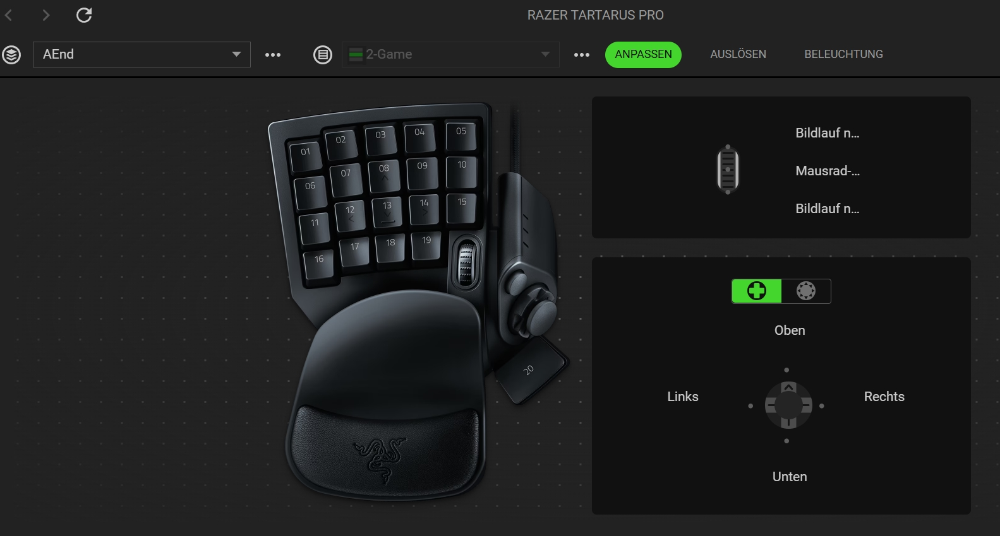
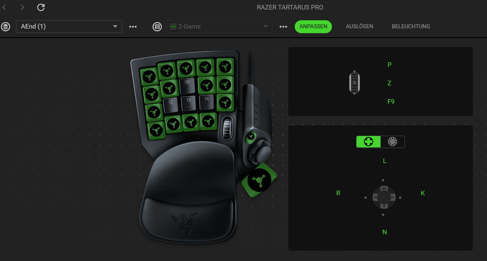

# Razer Synapse 4 — Profile Recovery

**Recover lost custom keybindings from historical Synapse diagnostic logs.**

> **Project status: documented successful recovery / community guide in progress.**
> This repository currently documents a real, successful case. The automated data collector and general-purpose recovery tool are **not released yet**. Recovery is not guaranteed, and procedures confirmed for one device or software version may not work for another.

This is an independent community project. It is **not affiliated with, endorsed by, or supported by Razer**.

## ❌ Before / ✅ After — real recovery case

| ❌ BEFORE — Profile corrupted | ✅ AFTER — Profile recovered |
| :---: | :---: |
|  |  |
| **Original profile `AEnd`** — The profile name and `2-Game` keymap still existed, but custom mappings were missing. The device executed default keybindings. | **Recovered profile `AEnd (1)`** — Custom mappings were restored from historical diagnostic logs, imported as a **separate profile**, and verified to work on the actual hardware. |

*These are the original before/after screenshots from the successful recovery, not generated illustrations. Green highlighting is specific to the shown configuration; test the real key outputs rather than relying only on appearance.*

## The problem

Razer Synapse may still display a familiar device profile and keymap even when the actual custom key assignments are missing. In the documented case, the profile was **not intentionally deleted**, and manually testing the Tartarus Pro confirmed that the device had reverted to its default commands. The cause of the loss has **not** been conclusively established.

The key discovery was that **older, intact profile states were still present in local Synapse diagnostic logs**. These could be compared against the current empty state and used to reconstruct an importable profile.

## ✅ Successfully tested environment

| Component | Tested configuration |
|---|---|
| Recovery date | October 10, 2026 |
| Device | Razer Tartarus Pro |
| Software | Razer Synapse 4, version `4.0.86.2610010314` |
| Original profile | `AEnd` |
| Keymap | `2-Game` |
| Last intact logged state | October 9, 2026, approximately 13:08 local time |
| Later empty state | October 9, 2026, approximately 13:17 local time |
| Historical mapping entries recovered | 33 (not necessarily 33 distinct physical keys) |
| Assistant used | **ChatGPT Plus — GPT-6 — High thinking effort** |
| Outcome | Reconstructed `.synapse4` profile successfully imported; custom keybindings tested and confirmed working |

**Important:** ChatGPT Plus / GPT-6 / High are the settings used in this particular successful case, **not proven minimum requirements**. Other models or plans have not been validated as part of this case study. An AI-generated recovery file must still pass structural checks and be tested in Synapse.

## 🚨 Before attempting recovery

1. **Stop changing the affected keymap** until you have backed up the available evidence. Continued activity may rotate or overwrite useful logs.
2. **Export your current Synapse profiles** using the app's profile export function, even if the affected profile appears empty. Keep the original `.synapse4` file unchanged.
3. Save a **separate backup of local Razer data**, especially `%LOCALAPPDATA%\Razer\RazerAppEngine\User Data\Logs` if it exists. Do not move, delete, reset, or edit the live files.
4. Avoid uninstalling or reinstalling Synapse as a first step. Doing so can destroy potentially useful evidence.
5. **Never publish raw logs, exported profiles, account identifiers, or recovery archives in a public GitHub issue or forum post.** They may contain sensitive local paths, device identifiers, profile data, and other personal information.

The project is designed around **read-only evidence collection**, offline reconstruction, and **manual** import. It must never silently modify the active Synapse database.

## How the successful recovery worked

1. Enumerate the local Razer folders and collect relevant logs, including files associated with the affected device and its profile/mapping engines.
2. Locate historical profile snapshots and group them by **device, profile ID, and keymap ID** rather than relying on display names alone.
3. Compare snapshots chronologically. In the reference case, the affected keymap went from **33 mapping entries to zero** while other profiles remained intact.
4. Export the *currently recognized* profile from Synapse as an **original format reference**.
5. Reconstruct a **separate copy** using verified historical assignments and compatible settings, while preserving identifiers and unrelated data as appropriate.
6. Decode and validate the original export structure. For the **tested Synapse version**, the profile data was Base64-encoded JSON and an MD5 value could be reproduced from a canonical JSON representation. The reconstructed content needed a **new, matching hash**; reusing the original hash caused the first import attempt to fail.
7. Import the corrected file via **Synapse → Profile → Import → Local**. Synapse created a new profile, `AEnd (1)`, leaving the original `AEnd` in place.
8. Test the actual key outputs, then **export the recovered working profile immediately** and keep an offline backup.

**Do not assume** every Razer device, log, macro, or future `.synapse4` version uses this same structure or hashing process. Also, historical mappings that reference separate macro definitions may require those definitions to be recovered independently.

## Recovery with ChatGPT — planned guided workflow

A future read-only PowerShell collector will package the necessary evidence and report missing or unreadable files. Until that tool has been written and tested, this repository **does not provide a one-click recovery process**.

The intended process is:

**Collect evidence locally → review sensitive contents → upload privately to ChatGPT → analyze historical states → construct and validate a new `.synapse4` copy → manually import → test → export a backup.**

### Starter prompt

> I am trying to restore a Razer Synapse 4 device profile whose custom keybindings have reverted to defaults. I have an unchanged `.synapse4` export and local Synapse diagnostic logs. Please inspect the files without inventing missing data. Locate historical device/profile/keymap snapshots, compare their timestamps and mapping counts, and identify the last intact state. Validate the original export format and any integrity hash before constructing a **separate** recovered import file. Do not overwrite my originals, do not assume one device's format applies to another, and explain precisely what can and cannot be recovered. If the evidence is insufficient, stop and tell me what is missing. Before any import, give me a verification report and a safe manual test procedure.

This prompt alone is **not** a recovery tool. A successful outcome requires intact historical evidence, correct parsing, a compatible export, and validation.

## Technical observations (reference case only)

- Windows log directory observed: `%LOCALAPPDATA%\Razer\RazerAppEngine\User Data\Logs`
- Relevant filenames included `products_580_ui*.log`, `profiles*.log`, and `mapping_engine*.log`.
- A separate `Devices\Restore\5426_580.json` was found, but it contained **HID device restore metadata, not the lost keybindings**.
- The profile and keymap IDs were matched between the current export and the historic logs.
- The original export was recognized by Synapse, whereas an initially reconstructed file with an out-of-date hash was rejected. After recalculating the hash for the rebuilt payload, Synapse accepted the profile and the restored keys worked.

These observations should be treated as **one confirmed case**, not a guarantee of support for all Synapse releases or Razer products.

## Roadmap

- [x] Document a successfully verified Tartarus Pro recovery case
- [x] Publish genuine before-and-after screenshots
- [x] Record the tested ChatGPT configuration
- [ ] Build and test a read-only PowerShell diagnostic collector
- [ ] Publish a deterministic export-format validator
- [ ] Publish a safe, version-aware recovery workflow
- [ ] Test multiple keymaps, devices, Synapse builds, macros, and failure scenarios
- [ ] Publish an expanded step-by-step English guide and a German translation
- [ ] Add an explicit project license and contribution policy

## Community reports and privacy

When opening an issue, include **device model, Synapse version, a concise description, and whether profile names remain visible**. You may share **redacted** screenshots showing the before/after state. Do **not** attach raw logs, private exports, credentials, account IDs, or unredacted diagnostic archives to public issues.

This is a volunteer community effort. It may help recover data from logs, but it **cannot reconstruct information that no longer exists in any available source**.

---

*Razer and Razer Synapse are trademarks of their respective owner. This independent guide is based on a user-verified recovery completed on October 10, 2026.*
